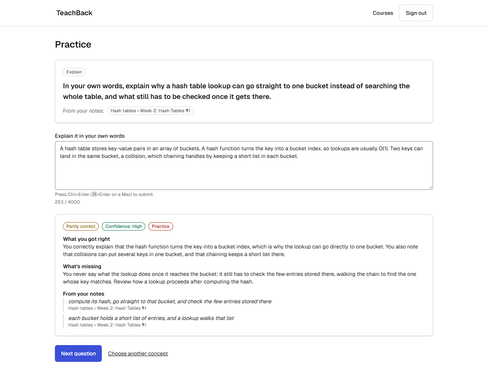
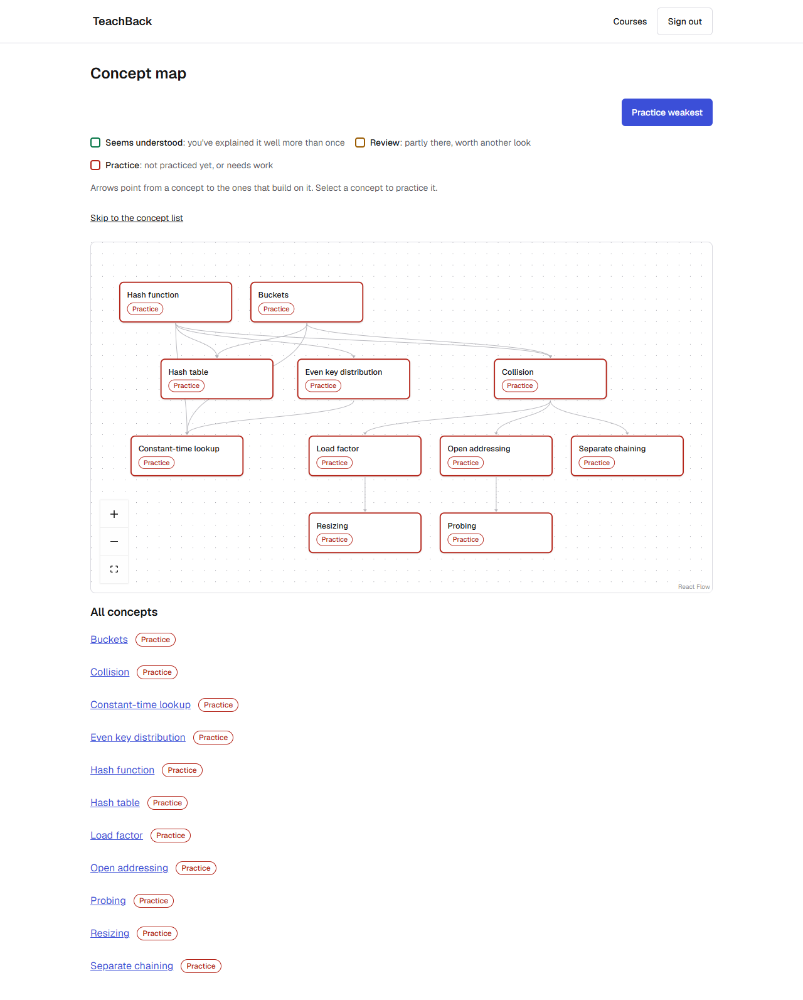
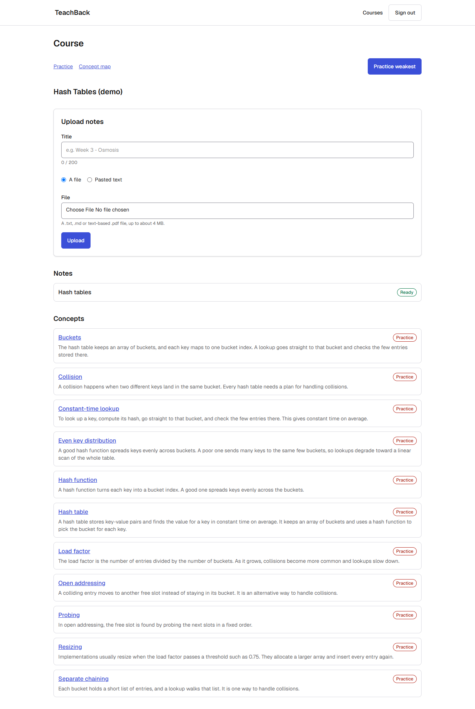

# TeachBack

**Notes that teach you back.** Upload your lecture notes, explain a concept in your own words, and get feedback that quotes your own notes and says how sure it is. A concept map shows what you've got and what to review next.

Built in 10 days (Oct 29 – Nov 7, 2026) by a team of three. Everything runs on your own machine; there's no hosted version.

## Contents

- [What it does](#what-it-does)
- [Run it locally](#run-it-locally)
- [Fake AI or real Claude](#fake-ai-or-real-claude)
- [Databases: stop, restart, fix](#databases-stop-restart-fix)
- [Tests](#tests)
- [How grounding and confidence work](#how-grounding-and-confidence-work)
- [Security](#security)
- [Stack and architecture](#stack-and-architecture)
- [API docs](#api-docs)
- [Team](#team)
- [Known limitations](#known-limitations)

## What it does

1. **Upload notes** to a course: paste text, or upload a `.txt`, `.md` or text-based PDF.
2. **Concepts are extracted** from the notes, each linked to the passages it came from, with "leads to" links between them.
3. **Practice:** pick a concept (or let "Practice weakest" pick one) and get a question that can be answered from your notes alone.
4. **Explain it in your own words.** The feedback says what you got right, what's missing, and **quotes the parts of your notes it relied on**. Every quote is checked against your notes before you see it.
5. **It says when it isn't sure.** Each piece of feedback has a confidence level. If the grading can't be backed by your notes, it says so, and your progress isn't changed.
6. **The concept map** colours each concept by how well you know it: _Practice_, _Review_ or _Seems understood_.

These screenshots come from real Claude, working on the fictional demo notes in `fixtures/seed/`.

**Feedback that quotes your notes.** The question comes from your notes. The grade says what you got right and what's missing, and every quote is checked against the notes before it's shown.



**The concept map.** Each concept is coloured by how well you know it, with arrows to the concepts that build on it. "Practice weakest" picks what to do next.



**A course.** Upload notes, see their status, and the concepts found in them, each with a one-line summary.



## Run it locally

Works on Windows and macOS (and Linux). Most of the setup time is `npm install` and the first run of the checks.

### 1. Prerequisites

| Tool           | Version                    | Install                                                                                                                                                         |
| -------------- | -------------------------- | --------------------------------------------------------------------------------------------------------------------------------------------------------------- |
| Node.js        | 24 or newer (24 LTS or 26) | Windows: `winget install OpenJS.NodeJS.LTS`. macOS: the LTS from [nodejs.org](https://nodejs.org) or `brew install node`                                        |
| npm            | 11.11 or newer, below 12   | Comes with Node 24/26. Check with `npm -v`. If you upgraded npm yourself, run `npm install -g npm@11` from outside the project folder                           |
| Git            | any recent                 | Windows: `winget install Git.Git`. macOS: `xcode-select --install`                                                                                              |
| Docker Desktop | any recent                 | [docker.com](https://www.docker.com/products/docker-desktop/). On Windows, accept the **WSL 2** option. Start it and wait for "Engine running" before you go on |

npm enforces the Node and npm versions (`devEngines` in `package.json`): on another version, `npm install` stops with `EBADDEVENGINES`.

### 2. Clone and set up

```bash
git clone https://github.com/jbarra2/teachback.git
cd teachback
npm run setup
```

`npm run setup` is safe to run again at any time. It:

- checks the prerequisites above and tells you how to fix anything missing;
- creates **`.env`** from `.env.example` (readable only by you) and generates a random `BETTER_AUTH_SECRET`. It never overwrites an existing `.env`, and only adds variables that are missing;
- runs `npm install`, turns on the git hooks, and downloads the browser the end-to-end tests use (Playwright's Chromium);
- starts two Postgres 17 containers, bound to your machine only:
  - **`db`** on `127.0.0.1:5433`: your development data, kept in a Docker volume;
  - **`db-test`** on `127.0.0.1:5434`: for the integration tests, held in memory and emptied on restart;
- applies the database migrations and loads the [demo accounts](#demo-accounts);
- runs the quick checks (`npm run check`, then the integration tests). Skip them with `npm run setup -- --skip-verify`.

### 3. Start the app

```bash
npm run dev
```

Open **<http://localhost:3000>**. Next.js prints `http://127.0.0.1:3000`; if you open that, the app hands you over to `localhost` straight away, because sign-in cookies and the cross-site check work on the one address in `BETTER_AUTH_URL`. The API docs are at <http://localhost:3000/api/docs>.

The app listens on your machine only. It uses port **3000**; the databases use **5433** and **5434**.

### Demo accounts

Setup loads demo data with `npm run db:seed`. You can run it again at any time: it never resets the demo accounts' progress or changes a password. These accounts exist only in your local database, and the seed refuses to run in production.

| Account        | Email                   | Password          | Has                                                                        |
| -------------- | ----------------------- | ----------------- | -------------------------------------------------------------------------- |
| Demo student A | `demo-a@teachback.test` | `demo-password-a` | A course with sorting-algorithm notes, 5 concepts and 2 practice questions |
| Demo student B | `demo-b@teachback.test` | `demo-password-b` | A small course of their own, for cross-user checks                         |

If you already signed up with one of these emails using a different password, the seed leaves that account alone and says so. Delete it yourself if you want the demo account back.

To try the security model, sign in as demo student B and open one of demo student A's course URLs: every page and API call answers "not found".

You can also sign up with any email (nothing is sent) and upload your own notes. `fixtures/notes/` has a few sample files to upload.

## Fake AI or real Claude

**By default the app uses a fake AI** (`AI_PROVIDER=fake` in `.env`). It's free, needs no key, and gives fixed, deterministic answers: concepts, questions and feedback are canned, but every screen and every rule around them (evidence checks, confidence, mastery) runs for real. The tests and CI always use it.

**To use real Claude**, edit `.env`:

```bash
AI_PROVIDER=anthropic
ANTHROPIC_API_KEY=your-key-here
```

Then check the key with one tiny real call, and restart `npm run dev`:

```bash
npm run ai:ping      # ✔ AI ping OK (claude-sonnet-5-5): {"ok":true}
```

`ai:ping` always uses the real API, prints only the model and the result or an error code, and never prints the key.

- Concept extraction and questions use `AI_MODEL_FAST` (default `claude-sonnet-5-5`). Grading uses `AI_MODEL_SMART` (default `claude-opus-5-5`). Both are set in `.env`.
- Real calls cost money. Each user is limited per minute and per day (`RATE_LIMIT_AI_PER_MIN`, `RATE_LIMIT_AI_PER_DAY`), uploads per hour (`RATE_LIMIT_UPLOADS_PER_HOUR`), and the whole app per day (`RATE_LIMIT_AI_GLOBAL_PER_DAY`).
- Never commit `.env`. It's in `.gitignore`, and a pre-commit hook and CI scan for secrets.

## Databases: stop, restart, fix

```bash
npm run db:down     # stop both database containers
npm run db:up       # start them again
```

`db:down` stops the containers but **keeps your data**: the development database lives in a Docker volume (`teachback_pgdata` if you cloned into a folder called `teachback`), which survives stops, restarts and reboots. Don't add `-v` (`docker compose down -v`): that deletes the volume and every account and note in it. Then `npm run setup` would start you from an empty database with fresh demo data.

After pulling new code, run `npm run db:update` to apply any new migrations.

### Troubleshooting

| Problem                                                                       | Fix                                                                                                                                                                                                       |
| ----------------------------------------------------------------------------- | --------------------------------------------------------------------------------------------------------------------------------------------------------------------------------------------------------- |
| Setup says **"Docker is installed but not running"**                          | Start Docker Desktop, wait for "Engine running", then run `npm run setup` again.                                                                                                                          |
| **"Could not start the Postgres containers"** (port 5433 or 5434 in use)      | Another Postgres is using the port. Find it with `docker ps` (or a local Postgres service) and stop it, then run `npm run setup` again.                                                                   |
| **Port 3000 in use**                                                          | Stop the other app on port 3000. Next.js would otherwise move to 3001, where sign-in doesn't work, because the app only accepts requests from the address in `BETTER_AUTH_URL` (`http://localhost:3000`). |
| **Sign-in or sign-up fails, or every form gives an error (HTTP 403)**         | You're on another port, or `BETTER_AUTH_URL` in `.env` isn't `http://localhost:3000`. Open <http://localhost:3000>, and fix `.env` if you changed it.                                                     |
| **`npm error code EBADDEVENGINES`**                                           | Wrong Node or npm version. Install the current Node LTS, and check that `npm -v` is 11.11 or newer and below 12.                                                                                          |
| **Database errors after pulling**                                             | `npm run db:update`                                                                                                                                                                                       |
| **The test database isn't running** (from `npx vitest` or `npm run test:int`) | `npm run db:up`                                                                                                                                                                                           |
| **A page keeps reloading itself** right after `npm run dev` starts            | Stop `npm run dev`, delete the `.next/dev` folder (Next's build cache, rebuilt on start), and start it again. See [Known limitations](#known-limitations).                                                |
| **The end-to-end tests say Chromium is missing**                              | `npx playwright install chromium` (setup does this for you).                                                                                                                                              |
| Anything else during setup                                                    | Run `npm run setup` again: it's safe to repeat and says what's wrong.                                                                                                                                     |

## Tests

| Command            | What it runs                                                                                                                                                                                                                                                                                                | Needs              |
| ------------------ | ----------------------------------------------------------------------------------------------------------------------------------------------------------------------------------------------------------------------------------------------------------------------------------------------------------- | ------------------ |
| `npm run verify`   | **The full gate, the same as CI:** formatting, lint (with security rules), types, OpenAPI lint, client types up to date, unit + integration tests with coverage, dependency audit, production build, end-to-end tests                                                                                       | Docker (`db-test`) |
| `npm run check`    | The fast subset: formatting, lint, types, unit tests. The pre-push hook runs this                                                                                                                                                                                                                           | nothing            |
| `npm run test`     | Unit and component tests (Vitest, Testing Library)                                                                                                                                                                                                                                                          | nothing            |
| `npm run test:int` | Integration tests: real Postgres, real sign-in sessions, every API route called as a function, fake AI                                                                                                                                                                                                      | Docker (`db-test`) |
| `npm run test:ci`  | Unit + integration with coverage thresholds                                                                                                                                                                                                                                                                 | Docker (`db-test`) |
| `npm run test:e2e` | End-to-end tests in a real browser (Playwright, Chromium): sign up → course → upload → practice → feedback → map, signed-out redirects, another user's data, script in names and answers, security headers, forms before the page loads, tap targets at phone width. Starts its own dev server on port 3100 | Docker (`db-test`) |
| `npm run api:lint` | Lints `openapi/openapi.yaml`                                                                                                                                                                                                                                                                                | nothing            |
| `npm run eval`     | The grading eval: 12 graded answers and 3 prompt-injection cases against **real Claude** (costs a little). Results in [docs/eval.md](docs/eval.md)                                                                                                                                                          | a real API key     |

- **Every API route** has the security matrix in its integration tests (no session → 401, another user's data → 404, cross-site request → 403, unknown or oversized input → 400/413, rate limits → 429, and more): [docs/TESTING.md §3](docs/TESTING.md).
- **Every response** in the integration tests is checked against the OpenAPI contract, and a contract test fails if a route exists without a spec entry or the other way round.
- **Coverage thresholds** are enforced on the server code, with 100% on the API wrapper every request passes through: [docs/TESTING.md §4](docs/TESTING.md).
- **CI** (GitHub Actions) runs all of the above except the eval on every pull request, plus a secret scan (gitleaks), CodeQL and a lockfile check. `main` only accepts changes through pull requests with green checks.

## How grounding and confidence work

TeachBack's feedback has to be backed by **your** notes, and it has to say when it isn't.

1. **Your notes are split into sections** when you upload them. Each concept is linked to the sections it came from.
2. **Questions** are generated only from a concept's own sections, and each question shows which part of your notes it comes from.
3. **Grading:** Claude gets the question, the concept's sections and your answer, and returns a verdict (correct / partly correct / not quite), what you got right, what's missing, 1–3 quotes from your notes, a confidence level, and whether your answer goes beyond your notes. The output must match a fixed schema, and is validated again by the server.
4. **Every quote is checked by plain code**, not by the model. A quote survives only if it really appears, word for word, in the section it cites (after evening out whitespace, quote marks and case), and is at least three words long.
   - If any quote fails, confidence is lowered to at most **Medium**.
   - If every quote fails, confidence becomes **Low** and the feedback is marked **"Couldn't verify this against your notes"**.
5. **Low confidence doesn't change your mastery.** Unverified feedback is shown, labelled, and otherwise ignored.

**Mastery** per concept starts at 0. Each graded answer moves it halfway towards the result (correct = 1, partly = 0.5, not quite = 0):

| State                | Rule                                       |
| -------------------- | ------------------------------------------ |
| **Seems understood** | score ≥ 0.75 after at least 2 answers      |
| **Review**           | at least 1 answer and score ≥ 0.4          |
| **Practice**         | everything else, including unseen concepts |

"Practice weakest" picks a _Practice_ concept before a _Review_ one, and the lowest score first. The answer and the mastery update are saved in one transaction, with an atomic update, so two answers at once can't lose an update.

Your notes and your answer are always sent to Claude marked as untrusted data, and the instructions tell it to ignore any instructions inside them. Its output is never run, and is shown only as plain text.

## Security

The app follows a written threat model ([docs/TESTING.md §8](docs/TESTING.md)). In short:

| Threat                     | What the app does                                                                                                                                                                             |
| -------------------------- | --------------------------------------------------------------------------------------------------------------------------------------------------------------------------------------------- |
| Seeing someone else's data | Every database query is scoped to the signed-in user. Another user's course, note, concept or question answers **404**, exactly like one that doesn't exist                                   |
| Missing sign-in            | Every API route goes through one wrapper (`withApi`) that requires a session unless the route is explicitly public                                                                            |
| Cross-site request forgery | Changes are refused when the request comes from another site (`Origin` and `Sec-Fetch-Site` checks), and cookies are `SameSite=Lax`                                                           |
| Cross-site scripting       | Everything you type is shown as text, `dangerouslySetInnerHTML` is banned by lint and by a test, and pages carry a nonce-based Content Security Policy                                        |
| SQL injection              | Prisma only. Raw unsafe queries are banned by lint                                                                                                                                            |
| Unexpected fields          | Every request body is validated by a strict schema that rejects unknown fields                                                                                                                |
| Malicious uploads          | File type checked by extension and content, size checked before parsing, text limits, UTF-8 validation, PDF page and time limits, PDFs parsed in a separate process. Nothing is saved to disk |
| Prompt injection           | Notes and answers are wrapped as data, output must match a schema, and every quote is checked against your notes                                                                              |
| Running up the AI bill     | Per-user rate limits, a daily cap for the whole app, size limits, and concept extraction only once per upload                                                                                 |
| Leaking secrets            | Secrets live only in `.env`. Secret scanning runs before each commit and in CI. Logs leave out cookies, note text and answers                                                                 |
| Leaking internals          | Errors are generic, with a request id for the logs. No stack traces, and no versions in the health check. If the database is down, pages show a short "can't load right now" page             |
| Vulnerable dependencies    | `npm audit` in CI, Dependabot, CodeQL, and a lockfile check that only allows the npm registry                                                                                                 |
| Session theft              | `httpOnly`, `SameSite=Lax` cookies (`Secure` in production) and HSTS in production                                                                                                            |
| Typed text in URLs         | Every form posts its fields, so even a submit before the page has loaded never puts a password, note or answer in a URL or a log                                                              |

## Stack and architecture

**Stack:** Next.js 16 (App Router, TypeScript) · PostgreSQL 17 in Docker · Prisma 7 · Better Auth (email and password) · Claude API (`@anthropic-ai/sdk`, structured outputs) · zod v4 · Tailwind CSS · React Flow + dagre for the map · `unpdf` for PDFs · Vitest, Testing Library and Ajv for tests · OpenAPI 3.1 with Scalar docs.

```
Browser (React; client components only where needed)
   │  typed client generated from openapi/openapi.yaml
   ▼
src/proxy.ts           CSP nonce + security headers, signed-out redirects
   ▼
src/app/api/**         every route wrapped in withApi():
   │                   session (401) · Origin check (403) · body limit (413) · rate limit (429)
   │                   · strict validation (400) · safe errors (500 + request id)
   ▼
src/lib/services       one service per route, owns all database access
src/lib/ai, ingest,    Claude calls (only through src/lib/ai/provider.ts), text extraction,
src/lib/mastery        chunking, evidence checks, mastery rules
   ▼
Prisma → PostgreSQL
```

- **Upload:** the file is checked and its text extracted, the document is saved, and the API answers right away (202). Processing continues in the background: the text is split into sections, Claude extracts the concepts outside any database transaction, and then one short transaction saves everything and marks the document ready (or failed, with a clear message). The page polls until it's done.
- **Answer:** grade with Claude, check the quotes, then one transaction saves the attempt and updates mastery.

The full spec, data model and conventions are in [docs/PLAN.md](docs/PLAN.md). How the team worked is in [CONTRIBUTING.md](CONTRIBUTING.md).

## API docs

With `npm run dev` running, open <http://localhost:3000/api/docs> for interactive API docs (Scalar). The contract itself is [openapi/openapi.yaml](openapi/openapi.yaml), written by hand before the routes. The integration tests check every response against it, and the frontend's API client types are generated from it (`npm run api:types`).

The docs page can be turned off with `API_DOCS_ENABLED=false`.

## Team

Each of us kept a journal of what we built, decided and learned: [docs/journal/](docs/journal/).

| Who                                                        | Role     | Built                                                                                                                                                                                                                                                                                                                                                                                                                                                                                                                                                      |
| ---------------------------------------------------------- | -------- | ---------------------------------------------------------------------------------------------------------------------------------------------------------------------------------------------------------------------------------------------------------------------------------------------------------------------------------------------------------------------------------------------------------------------------------------------------------------------------------------------------------------------------------------------------------- |
| Jonathan Barragan ([@jbarra2](docs/journal/jbarra2.md))    | Lead     | Project scaffold, tooling and CI; team workflow and one Node/npm version for everyone; the API contract and docs; the database and Better Auth; sign-in and the `withApi` route wrapper; the test setup (integration database, contract checks); the courses, map and next-concept APIs; the security baseline (rate limits, CSP and headers, safe logging); the documents API and processing pipeline; question generation; mastery updates; wiring every screen to the real API; the grading eval and prompt-injection cases; the bug bash and its fixes |
| Husein Sheikh ([@hsheik20](docs/journal/hsheik20.md))      | AI       | The Claude API wrapper and fake provider with failure modes; text extraction and upload validation; the chunker; evidence verification; Windows support for the PDF tests; the demo seed; answer grading; the end-to-end tests                                                                                                                                                                                                                                                                                                                             |
| Travis Vinay ([@TravisVinay](docs/journal/TravisVinay.md)) | Frontend | The app shell, sign-in pages and error screens; the notes library and upload screens; the practice session; the concept map; the feedback display; "Practice weakest"; the UI polish and accessibility pass                                                                                                                                                                                                                                                                                                                                                |

## Known limitations

- **Local only.** There's no hosted version; run it with the steps above.
- **Text-based PDFs only.** Scanned PDFs and images aren't read (no OCR). PDFs are limited to 100 pages, uploads to 4 MB and 200,000 characters of text.
- **The fake AI is canned.** Without a real key, concepts, questions and feedback are fixed examples. Use real Claude to judge the quality of the grading.
- **AI grading can be wrong.** Quotes are checked against your notes, but the verdict itself is the model's judgement. The confidence level and the "Couldn't verify" notice are there to show when to doubt it.
- **Accounts are basic:** email and password, no email verification and no password reset.
- **No editing or deleting** of courses and notes from the app yet.
- **A document still processing after 10 minutes** is shown as failed. Upload it again.
- **`npm run dev` can reload a page in a loop** right after it starts ([#97](https://github.com/jbarra2/teachback/issues/97)). It looks like a stale development build cache: stop the server, delete `.next/dev` and start again. A production build isn't affected.
- **The file picker is the browser's own** ("Choose File"), not yet styled to match the app ([#98](https://github.com/jbarra2/teachback/issues/98)).
